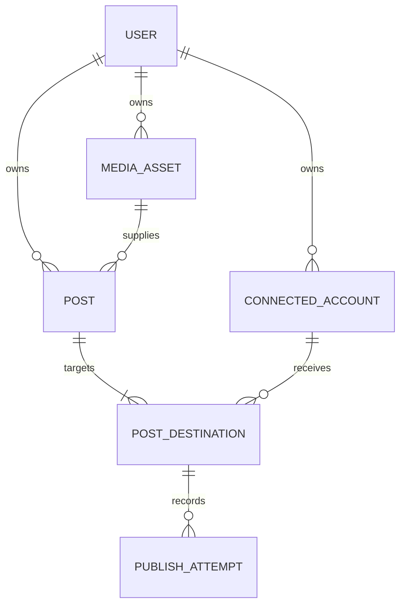

# Records and publishing behavior

| Record | Stored fields |
| --- | --- |
| User | ID, unique email, optional unique username, Argon2 password hash, creation time |
| Connected account | Owner, platform, platform account ID, display name, granted scopes, encrypted token bundle, expiry, connection status |
| Media asset | Owner, private R2 object key, filename, detected/validated type, size, dimensions/duration, validation result |
| Post | Owner, media reference, caption, UTC schedule, overall state, platform options, idempotency key and request fingerprint |
| Post destination | Post/account references, state, provider job ID, platform post ID, attempt count, retry time, lease, last error |
| Publish attempt | Destination, start/finish times, outcome, safe error code/message, retry time, returned platform post ID |

Login sessions and OAuth states are supporting tables. Cookies contain random opaque tokens; the database holds their SHA-256 digests. Provider tokens are encrypted with Fernet. API serializers exclude ciphertext and credentials. Ownership is checked when using accounts/media or reading/retrying posts.



The API saves a post and its destinations in one database transaction. A repeated submission with the same owner/key/body returns the existing post. Reusing the key with different content returns 409. The frontend retains the last key in session storage until a successful response.

PostgreSQL workers claim due destinations with `FOR UPDATE SKIP LOCKED`. A 10-minute lease identifies interrupted work. No in-memory timer or web request must remain alive for a schedule to fire. Use one worker for the local SQLite demo; SQLite does not provide PostgreSQL's row-locking semantics.

Typical destination states:

```text
queued → publishing → processing → published
                    ↘ retry_wait → publishing
                    ↘ failed
                    ↘ needs_attention
```

Definite rate-limit responses and safe pre-publish failures receive exponential backoff, with up to five upload attempts. Polling checks a stored provider job ID and never starts a replacement upload. Ambiguous network failures or a worker crash before storing a returned provider ID require review; exactly-once publishing cannot be guaranteed across an external platform and our database. The UI will not automatically retry an unknown publish outcome without a known job ID.

Manual retries affect only one destination. A successful sibling is not replayed. A post becomes `published` when all destinations succeed, `partial_failure` when some succeed and the rest fail, or `needs_attention` for uncertain outcomes. Active jobs retain `publishing` as the overall state. TikTok's private posts may have a publish job ID but no public post ID. YouTube's published state means its selected visibility (including private) has finished processing.

Uploads are authenticated and validated before storage. Image bytes are inspected by Pillow; MP4 containers, H.264 codec, dimensions and duration are inspected with ffprobe. Validation errors return 422 and do not create publishable media records. Files use immutable owner/UUID object keys, never user-supplied paths. This version buffers up to 64 MiB per media operation; size the API/worker host accordingly and keep upload concurrency conservative.

TikTok uses a signed, two-hour URL on `media.pxster.xyz/media-delivery/` (delivery Worker forwarding to the signed API endpoint). The handler serves private R2 bytes with range support. Register this URL prefix with TikTok. The R2 S3 hostname is not used as a TikTok verified public domain.

Migrations are versioned under `backend/migrations`. Run `alembic -c backend/alembic.ini upgrade head` before starting services. The initial migration is frozen rather than importing the current ORM metadata. Subsequent schema edits require a new migration. Sessions, expired OAuth states, and unused uploads currently need operational retention/cleanup jobs.
